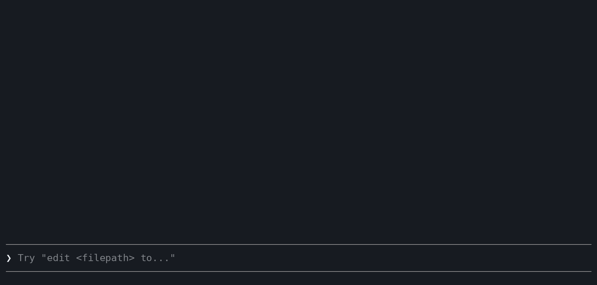

# unspin

[](https://github.com/nkyriazis/unspin/actions/workflows/ci.yml)
[](LICENSE)

**See what your coding agent's shell commands are doing, instead of a spinner.**

<p align="center">
  
</p>

When Claude Code runs a long shell command, you get the command and a spinner until it ends. Is it installing? On the fourth of fifty downloads? Stuck? You can't tell. unspin teaches the agent to mark the steps of its batched commands as it goes, and shows them live. Claude Code's own spinner names the step that is running, and a block above the prompt lists every step with a progress bar, its time and an ETA.

```
✻ Baking · building image 37/72, eta 33s… (1m 12s · ↓ 2.1k tokens)
▶ Ship the release  step 4/6 · 1m14s
  ✔ linting 1.2s
  ✘ running tests 120/120 — 1 of 120 failed 23s
  · test_88.py is a known flake, carrying on
  ⠴ building image 35s  ━━━━━───── 37/72 · eta 33s · layer sha256:ab12cd34ef56
```

## Install

unspin can show the flow in two places in Claude Code. Pick one, or both.

**In the spinner and above the prompt**, as in the demo. Install the plugin, from inside Claude Code 2.1.287 or newer. Your settings stay as they are.

```
/plugin marketplace add nkyriazis/unspin
/plugin install unspin@unspin
```

**Under your status line**, also in Claude Code before 2.1.287. Run the installer. It copies unspin to `~/.local/share/unspin`, links the skill and the `unspin` command, adds two hooks, and draws the flow under the status line you already have, after backing up `settings.json`.

```bash
curl -fsSL https://raw.githubusercontent.com/nkyriazis/unspin/main/install.sh | bash
```

**Both.** Install the plugin first, then run the installer with `--statusline`. With the plugin in place, it only adds the status line.

```bash
curl -fsSL https://raw.githubusercontent.com/nkyriazis/unspin/main/install.sh | bash -s -- --statusline
```

To see it work, ask Claude to run the `unspin demo` command. `UNSPIN_SPINNER=0` or `UNSPIN_BAND=0` turns off either part of the plugin.

**Other agents.** `npx skills add nkyriazis/unspin` installs the skill for Codex, Gemini CLI, opencode, Cursor, Goose and the other agents `skills` knows about. [Where it shows](#where-it-shows) says what you see in each.

**From a clone.** `git clone https://github.com/nkyriazis/unspin && unspin/install.sh` installs that working copy.

## What the agent writes

You don't write any of this. Claude does, whenever it batches several steps or starts something long, because the skill teaches it to.

```bash
source "${CLAUDE_SKILL_DIR}/unspin.sh"
flow "Ship the release" 6
run -q "installing dependencies" npm ci
flow_each -j 4 "optimizing images" assets/*.png -- optipng -quiet {}
run -p "building" ninja -C build
run "unit tests" npm test & run "lint" npm run lint & wait
flow_wait -t 60 "waiting for the preview" -- curl -sf localhost:3000/health
```

| Call | What it does |
|---|---|
| `flow "Title" [N]` | Starts a flow of N steps |
| `step "msg"`, `ok`, `fail`, `note "msg"` | Open a step, close it, or add a note |
| `run "msg" cmd…` | A step around one command, closed by its exit status. `-l` shows its latest output line, `-p` reads counts like `[3/10]` from it, `-q` keeps the output in a log and prints only the tail if it fails |
| `progress N [TOTAL] ["label"]` | Moves the bar. Counts can carry units (`1.2G/4G`) or be percentages |
| `flow_each [-j N] "msg" items… -- cmd {}` | A loop with one bar, the current item and a failure tally, N at a time |
| `flow_wait [-t SECS] "msg" -- cmd…` | Retries until cmd succeeds, with a bar for the time |
| `cmd \| flow_lines [-p]` | Counts output lines as progress, or reads counts from them |

Jobs started with `&` each get their own row. The [skill](skills/unspin/SKILL.md) has the details the agent reads.

## Where it shows

| Where | How |
|---|---|
| Claude Code's spinner, and the band above the prompt | the plugin |
| Under your Claude Code status line | `unspin setup`, which the installer runs |
| Your own status line script | `unspin block "$session_id"` prints the block, or nothing |
| ccstatusline and other status line builders | a custom command running `unspin statusline --line` |
| A second terminal or a tmux pane | `unspin watch` |
| The tmux status bar | `set -g status-right '#(unspin tmux)'` and `set -g status-interval 1` |
| Codex, Gemini CLI, opencode, Goose, Cline, Cursor, Amp | each step is also printed to the command's stderr, which these agents show |

## How it works

The helper appends one line per event to a file for the agent session, in `$XDG_RUNTIME_DIR/unspin` or `/tmp/unspin-<uid>`. The plugin reads that file twice a second and the status line once a second, and both draw it. No daemon runs and nothing goes over the network. The helper writes to that file and not to stdout, so the agent still reads the command's own output.

Each event is a plain line of text, so anything that can append to a file can report progress. A Python loop, a Makefile and a hand-typed `echo` all work. The format is in [docs/protocol.md](docs/protocol.md).

A step remembers the process that opened it. If that process dies before closing the step (you pressed Esc, the shell was killed), the step shows as interrupted instead of spinning forever. Steps that are running or have failed stay in view when later steps would push them out. A short reminder reaches Claude when it writes a batched command without the helper, at most once every five minutes. When you send your next prompt the finished flow is put away.

## Configuration

Set these in the environment, or under `env` in Claude Code's `settings.json`.

| Variable | Default | Effect |
|---|---|---|
| `UNSPIN_ROWS` | `4` | Steps shown under the header |
| `UNSPIN_SPINNER` | `1` | `0` keeps the plugin out of the spinner |
| `UNSPIN_BAND` | `1` | `0` keeps the plugin out of the band above the prompt |
| `UNSPIN_NUDGE` | `1` | `0` stops the reminder to instrument batched commands |
| `UNSPIN_ECHO` | auto | `1` also writes each step to stderr, `0` never does. Auto turns it on in agents without a live status line |
| `UNSPIN_ASCII` | `0` | `1` draws with plain ASCII |
| `NO_COLOR` | | Turns color off in the status line |
| `UNSPIN_DIR` | | Where flow files go |

## Works with

bash 3.2 (the one macOS ships) to 5.3, and zsh. gawk, mawk, busybox awk and BSD awk. Linux and macOS. The test suite runs the helper under each of these shells and the status line renderer under each of these awks, and the plugin's mod under Claude Code's own test kit.

## Troubleshooting

`unspin doctor` checks the install and says what to fix.

If the plugin is installed but nothing shows in the spinner or above the prompt, mods may be off for your account or organization. `claude --debug` logs why a mod did not load. The status line works either way, so until that changes, add it next to the plugin as in [Install](#install) under Both.

## Uninstall

The plugin goes with `/plugin uninstall unspin@unspin`. The installer's setup goes with `unspin uninstall`, which restores your status line and hooks, and then `rm -rf ~/.local/share/unspin` removes the files.

## License

MIT
